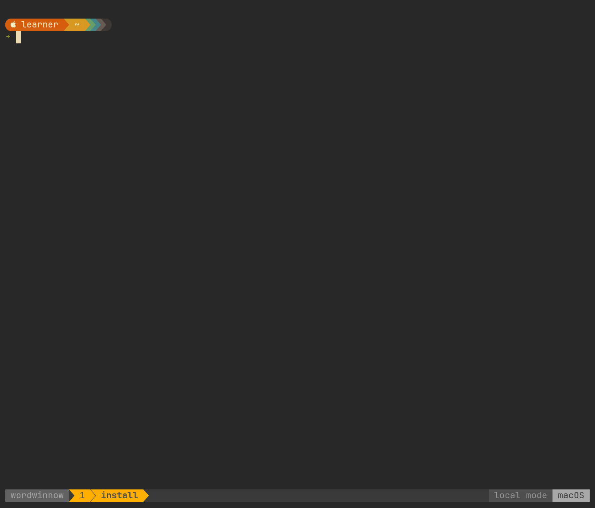
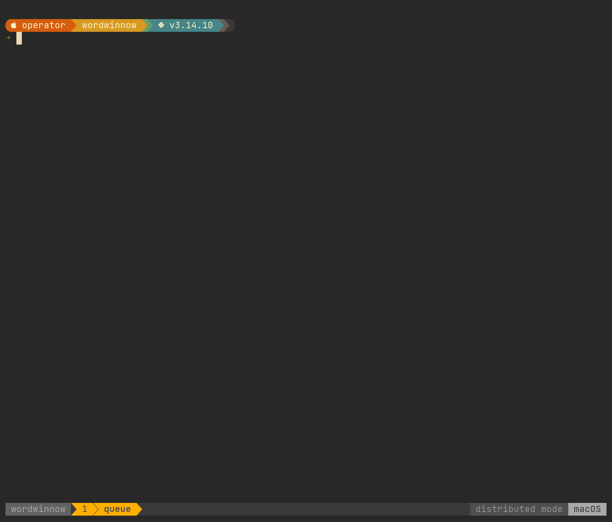

# Getting started

From nothing to a first report, on your own machine.

## Before you start

You need [`uv`](https://docs.astral.sh/uv/), which installs the command.

You need network access to install it and to set it up, for the packages, the
NLTK data, and the reference lists.

## Installing it

```sh
uv tool install --python 3.14 https://github.com/wordbench/wordwinnow/releases/download/v2.3.0/wordwinnow-2.3.0-py3-none-any.whl
```

That installs the `wordwinnow` command from the wheel attached to the 2.3.0
release, in an environment of its own, with the packages it needs.

`--python 3.14` names the Python version Wordwinnow is tested on, which uv
fetches if your system lacks it.

Without it, uv may install the command on a newer Python, one Wordwinnow is
not tested on.

## Setting it up

```sh
wordwinnow setup
```

It downloads whichever of NLTK's sentence splitter, tagger, stop words, and
WordNet are missing, as [one fixed commit of the NLTK project's data repository](https://github.com/nltk/nltk_data/tree/550b6625bcef1f2abff2ff770a5a0d272c9c6b2a)
holds them, into `~/nltk_data`, which other programs that use NLTK share.

It downloads the two reference lists from their distributor at one fixed
commit, checks each against the SHA-256 of the file published at that commit,
and trains the level model from them in under a minute.

It does only what is missing, and every analysis needs what it sets up, so it
comes before the first.

The lists and the model it sets up, the analysis store, and the dictionary
cache live in your user directories, not in the directory you run a command
from: `~/Library/Application Support/wordwinnow` and `~/Library/Caches/wordwinnow`
on macOS, `~/.local/share/wordwinnow` and `~/.cache/wordwinnow` on Linux, or
`$XDG_DATA_HOME/wordwinnow` and `$XDG_CACHE_HOME/wordwinnow` on either system when
those variables are set; [the configuration](https://github.com/wordbench/wordwinnow/blob/v2.3.0/docs/operating.md#configuration) can move each of them.

`setup`, `analyze`, `show`, `list`, and `doctor` write nothing in the directory you run
them from, except a file you name, such as `--csv`'s.

`wordwinnow doctor` says what is present and what is missing, and its first line
names the installed version and the Python it runs on, while
`wordwinnow --version` prints the version alone.

After you install another version, `analyze` stops and names `wordwinnow setup`
when the level model needs training again.

The recording installs a 2.4.0 wheel from a file, which `uv tool install` takes
in place of a URL, then sets it up.



## The first analysis

```sh
curl -sSfL https://raw.githubusercontent.com/wordbench/wordwinnow/v2.3.0/data/corpus/a-scandal-in-bohemia.txt | wordwinnow analyze - --level A2 --target B1 --no-dictionary
```

The `-` makes `analyze` read the text from standard input, which here is the story
`curl` fetches.

Standard input is read as plain text, or as subtitles when it holds SRT or
WebVTT cues; a whole web page, piped in or given as a file, is refused in one
line, because its markup, menus, and links would fill the list with words the
article does not use; extract the article's text first, as
[the operating guide](https://github.com/wordbench/wordwinnow/blob/v2.3.0/docs/operating.md#the-learners-commands) shows.

The report names the text and the learner, counts the words to study, and
lists them in study order, FOCUS first, up to 40 rows by default, each with
its level, how often the text uses it, and one meaning; `--rows` raises that
limit, `--tier` chooses which tiers to show, and the last line of the report is
the `wordwinnow show` command that shows it again.

The analysis runs inside the command, against a SQLite file in your user data
directory that the command creates and migrates itself.

`--no-dictionary` skips the dictionary, so the report comes back in a few
seconds with WordNet's glosses as meanings; drop the flag to get the Free
Dictionary API's definitions, examples, and pronunciation, which take longer,
because every distinct word to study, FOCUS and STRETCH, is a request to a
service outside Wordwinnow.

`--detail` prints one card per word, `--json` the whole analysis, `--csv FILE` the
shown words as CSV, and `--anki FILE` or `--quizlet FILE` the words to study as
flashcards.

In Anki, File, then Import, reads the file `--anki` writes as Basic notes, each
tagged with the word's level; in Quizlet, the file `--quizlet` writes is pasted
into a new flashcard set's import box.

A text of your own is `wordwinnow analyze FILE --level LEVEL`.

`wordwinnow list` lists what was stored, and `wordwinnow show ID` shows one
analysis again.

## Texts from The New York Times

<a href="https://developer.nytimes.com">
<picture>
<source
media="(prefers-color-scheme: dark)"
srcset="https://developer.nytimes.com/files/poweredby_nytimes_150c.png">

</picture>
</a>

```sh
wordwinnow analyze --source nyt-rss --topic Science --level B1 --no-dictionary
```

The feeds need no credential.

The report names The New York Times as the source and links every story, and
nobody can read the analysis after a day, because the text is theirs.

With a developer key in `WORDWINNOW_NYT_API_KEY`, the API sources appear as
well; `wordwinnow doctor` lists the sources the configuration enables,
`wordwinnow analyze --help` lists what each source expects as a topic, and
[`operating.md`](https://github.com/wordbench/wordwinnow/blob/v2.3.0/docs/operating.md) says where to keep the key, with or without direnv.

## Removing it

```sh
uv tool uninstall wordwinnow
```

That removes the command and its environment and leaves your user data and
cache directories and `~/nltk_data`, which you delete to remove the rest.

## From a clone

To inspect the source, run its gate, or start the distributed mode, work from
a clone.

```sh
git clone https://github.com/wordbench/wordwinnow && cd wordwinnow
```

```sh
make setup
```

```sh
make model
```

`make setup` creates the locked environment, and `make model` runs
`uv run wordwinnow setup`, which prepares the same user directories as the
installed command does.

`uv run wordwinnow` runs the checkout's own code, and `make demo` analyzes the
sample story with it.

Docker with Compose is needed only for the distributed mode and the
integration tests.

To run the gate or commit through the repository's hooks, you also need
[gitleaks](https://github.com/gitleaks/gitleaks) 8.30.1 on your `PATH`, the version the gate checks for: `make verify`
and the `pre-push` hook run its secret scan, and the `pre-commit` hook runs the
scan alone.

Its [release page](https://github.com/gitleaks/gitleaks/releases/tag/v8.30.1) has an archive for each platform, and a package manager
that carries that version works as well; analyzing a text never needs it.

The environment I develop Wordwinnow in, these tools included, is set up by my
[dotfiles](https://github.com/olegturzhanskii/dotfiles); nothing here depends on them.

## The distributed mode

The distributed mode runs from the clone, on one host, for that host's own
user, and its services listen on that host alone; the Security section of
[the operating guide](https://github.com/wordbench/wordwinnow/blob/v2.3.0/docs/operating.md#security) says what that boundary covers.

```sh
make up-full
```

That builds the image, which trains its own level model, and starts
PostgreSQL, Redis, Kafka, ClickHouse, the migration job, intake, enrichment,
one analysis worker, the aggregation worker, Prometheus, Tempo, and Grafana.

`make up-full` first writes the stack's two generated passwords, ClickHouse's
and Grafana's, into `.env` where they are absent, and it ends by saying where
Grafana is, `http://localhost:3000`, as user `admin`, with its password on the
`GRAFANA_ADMIN_PASSWORD` line of `.env`.

```sh
uv run wordwinnow analyze data/corpus/a-scandal-in-bohemia.txt --remote --level B1
```

With `--remote`, the command posts the text to intake, waits for a worker to
finish, and shows the result; `wordwinnow stats` then summarizes every completed
analysis from ClickHouse.

Only the words to study, FOCUS and STRETCH, are looked up: for a B1 learner
the story has 832 of them, which come to 810 requests to the provider, one per
distinct lemma, and the enrichment service sends them at up to two a second.

When last measured, the Free Dictionary API answered about one request a
second and refused the rest until each 20-second window ended: a first
analysis that looked up every word took over twenty-two minutes, so one that
looks up the words to study should take about thirteen, an estimate, and later
ones reuse the cache.

The command waits up to fifteen minutes, which `--timeout` changes, and the
analysis goes on whether or not it waits: when the wait ends, or Ctrl-C stops
it, the command names the analysis, `wordwinnow show ID --remote --wait` waits
for it again, and `wordwinnow show ID --remote` shows how far it has come, or
the result once it is done.

The recording runs the installed `wordwinnow`, which reaches the stack as
`uv run wordwinnow` does, and stops the worker first, so that the request waits;
once the worker is back, `show` finds the analysis looking its words up, and
`show --wait` follows it to the end.



`--view operator` draws, under the progress line, what the enrichment service's
dictionary client is doing meanwhile: the breaker, the bucket, the words at
the client, the last minute of the client's requests, and how the provider has
been answering, such as rate-limited or failing, and why; when the command
returns, the panel stays above the report, settled, and after the report the
command prints the analysis's figures, on standard error as well.

That panel differs from the local mode's, because the service looks words up
for every analysis it serves: what it draws of the client can come from other
analyses too, while `to ask`, `to ask again`, and `resolved N of M` are this
analysis's, from the progress its worker stores, and the tally is that count
alone; [the operating guide](https://github.com/wordbench/wordwinnow/blob/v2.3.0/docs/operating.md#the-operator-view) says what each part shows in either mode.

`WORDWINNOW_DICTIONARY=wordnet` in `.env` before `make up-full` answers from WordNet
instead, and the same analysis then took about five seconds, observed once on
the laptop the performance numbers come from.

`make down` stops everything and keeps the data, the analyses and the dictionary
cache among it, for the next `make up-full`; `make reset CONFIRM=1` deletes it.

## Checking it

```sh
make verify
```

That is the gate [`operating.md`](operating.md) describes, with the integration lane beside
it.

```sh
make test-installed
```

That builds the wheel, installs it as a learner does with its dependencies
resolved afresh, in a temporary home, sets it up, and analyzes the sample
story with the network closed to it, and it needs the network itself, for the
packages, the NLTK data, and the lists.

If you intend to commit, opt into the repository's hooks once per clone:

```sh
make hooks
```

The `pre-commit` hook runs the secret scan over the history and what you stage,
the `commit-msg` hook checks each message, and the `pre-push` hook runs
`make verify`.

## Where to go next

[`product.md`](https://github.com/wordbench/wordwinnow/blob/v2.3.0/docs/product.md) says what the tool is for and what it will not do.

[`operating.md`](https://github.com/wordbench/wordwinnow/blob/v2.3.0/docs/operating.md) covers every command, the configuration, and recovery.

[`domain.md`](https://github.com/wordbench/wordwinnow/blob/v2.3.0/docs/domain.md) defines the terms and says how a word gets its level.

If a command fails, `wordwinnow doctor` says what is present and what is
missing; [an issue](https://github.com/wordbench/wordwinnow/issues) with its output, the command, and your system is the way to
report it; for an analysis that failed, add what
`wordwinnow show ID --view operator` prints for it.
